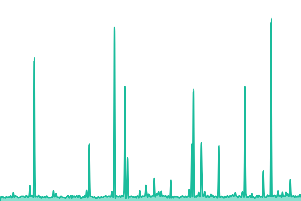
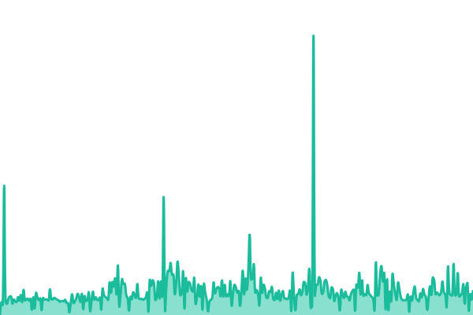
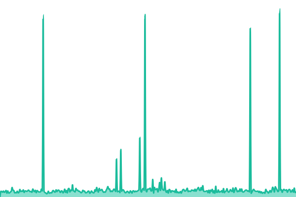
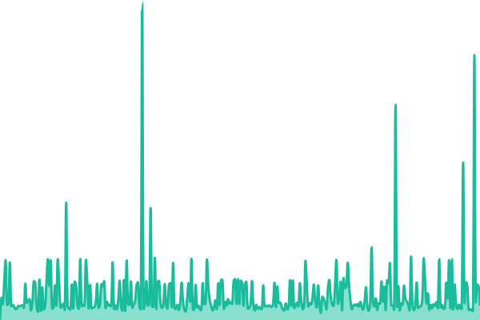
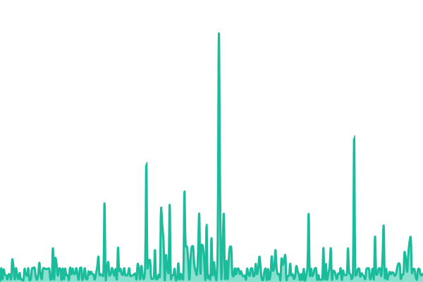
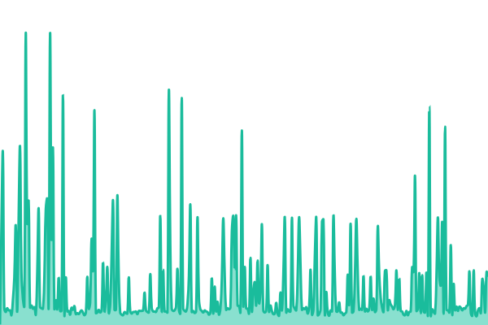
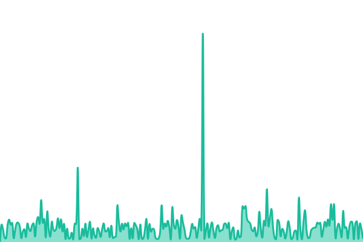

# [📈 Live Status](https://status.fuzevpn.com): <!--live status--> **🟩 All systems operational**

This repository contains the open-source uptime monitor and status page for [FuzeVPN](https://fuzevpn.com), powered by [Upptime](https://github.com/upptime/upptime).

With [Upptime](https://upptime.js.org), you can get your own unlimited and free uptime monitor and status page, powered entirely by a GitHub repository. We use [Issues](https://github.com/FuzeVPN/status/issues) as incident reports, [Actions](https://github.com/FuzeVPN/status/actions) as uptime monitors, and [Pages](https://status.fuzevpn.com) for the status page.

<!--start: status pages-->
<!-- This summary is generated by Upptime (https://github.com/upptime/upptime) -->
<!-- Do not edit this manually, your changes will be overwritten -->
<!-- prettier-ignore -->
| URL | Status | History | Response Time | Uptime |
| --- | ------ | ------- | ------------- | ------ |
|  [Website](https://fuzevpn.com) | 🟩 Up | [website.yml](https://github.com/FuzeVPN/status/commits/HEAD/history/website.yml) | 

 470ms
     
 | 

<a href="https://status.fuzevpn.com/history/website">100.00%</a>
    

|  [Web app](https://app.fuzevpn.com) | 🟩 Up | [web-app.yml](https://github.com/FuzeVPN/status/commits/HEAD/history/web-app.yml) | 

 516ms
     
 | 

<a href="https://status.fuzevpn.com/history/web-app">100.00%</a>
    

|  [Sign-in and new connections (API)](https://api.fuzevpn.com/healthz) | 🟩 Up | [sign-in-and-new-connections-api.yml](https://github.com/FuzeVPN/status/commits/HEAD/history/sign-in-and-new-connections-api.yml) | 

 219ms
     
 | 

<a href="https://status.fuzevpn.com/history/sign-in-and-new-connections-api">100.00%</a>
    

|  [VPN - Sao Paulo 01 (BR)](https://sao-paulo-01.fuzevpn.com/ping) | 🟩 Up | [vpn-sao-paulo-01-br.yml](https://github.com/FuzeVPN/status/commits/HEAD/history/vpn-sao-paulo-01-br.yml) | 

 194ms
     
 | 

<a href="https://status.fuzevpn.com/history/vpn-sao-paulo-01-br">99.74%</a>
    

|  [VPN - Frankfurt 01 (DE)](https://frankfurt-01.fuzevpn.com/ping) | 🟩 Up | [vpn-frankfurt-01-de.yml](https://github.com/FuzeVPN/status/commits/HEAD/history/vpn-frankfurt-01-de.yml) | 

 89ms
     
 | 

<a href="https://status.fuzevpn.com/history/vpn-frankfurt-01-de">100.00%</a>
    

|  [VPN - Frankfurt 02 (DE)](https://frankfurt-02.fuzevpn.com/ping) | 🟩 Up | [vpn-frankfurt-02-de.yml](https://github.com/FuzeVPN/status/commits/HEAD/history/vpn-frankfurt-02-de.yml) | 

 90ms
     
 | 

<a href="https://status.fuzevpn.com/history/vpn-frankfurt-02-de">100.00%</a>
    

|  [VPN - Gravelines 03 (FR)](https://gravelines-03.fuzevpn.com/ping) | 🟩 Up | [vpn-gravelines-03-fr.yml](https://github.com/FuzeVPN/status/commits/HEAD/history/vpn-gravelines-03-fr.yml) | 

 90ms
     
 | 

<a href="https://status.fuzevpn.com/history/vpn-gravelines-03-fr">100.00%</a>
    

|  [VPN - Gloucester 01 (GB)](https://gloucester-01.fuzevpn.com/ping) | 🟩 Up | [vpn-gloucester-01-gb.yml](https://github.com/FuzeVPN/status/commits/HEAD/history/vpn-gloucester-01-gb.yml) | 

 120ms
     
 | 

<a href="https://status.fuzevpn.com/history/vpn-gloucester-01-gb">100.00%</a>
    

|  [VPN - Hong Kong 01 (HK)](https://hong-kong-01.fuzevpn.com/ping) | 🟩 Up | [vpn-hong-kong-01-hk.yml](https://github.com/FuzeVPN/status/commits/HEAD/history/vpn-hong-kong-01-hk.yml) | 

 137ms
     
 | 

<a href="https://status.fuzevpn.com/history/vpn-hong-kong-01-hk">100.00%</a>
    

|  [VPN - Warsaw 01 (PL)](https://warsaw-01.fuzevpn.com/ping) | 🟩 Up | [vpn-warsaw-01-pl.yml](https://github.com/FuzeVPN/status/commits/HEAD/history/vpn-warsaw-01-pl.yml) | 

 87ms
     
 | 

<a href="https://status.fuzevpn.com/history/vpn-warsaw-01-pl">100.00%</a>
    

|  [VPN - Singapore 01 (SG)](https://singapore-01.fuzevpn.com/ping) | 🟩 Up | [vpn-singapore-01-sg.yml](https://github.com/FuzeVPN/status/commits/HEAD/history/vpn-singapore-01-sg.yml) | 

 73ms
     
 | 

<a href="https://status.fuzevpn.com/history/vpn-singapore-01-sg">100.00%</a>
    

|  [VPN - Philadelphia 01 (US)](https://philadelphia-01.fuzevpn.com/ping) | 🟩 Up | [vpn-philadelphia-01-us.yml](https://github.com/FuzeVPN/status/commits/HEAD/history/vpn-philadelphia-01-us.yml) | 

 111ms
     
 | 

<a href="https://status.fuzevpn.com/history/vpn-philadelphia-01-us">100.00%</a>
    

|  [VPN - Chisinau 01 (MD)](https://chisinau-01.fuzevpn.com/ping) | 🟩 Up | [vpn-chisinau-01-md.yml](https://github.com/FuzeVPN/status/commits/HEAD/history/vpn-chisinau-01-md.yml) | 

 73ms
     
 | 

<a href="https://status.fuzevpn.com/history/vpn-chisinau-01-md">100.00%</a>
    

<!--end: status pages-->

[**Visit our status website →**](https://status.fuzevpn.com)

## 📄 License

- Powered by: [Upptime](https://github.com/upptime/upptime)
- Code: [MIT](./LICENSE) © [Anand Chowdhary](https://anandchowdhary.com)
- Data in the `./history` directory: [Open Database License](https://opendatacommons.org/licenses/odbl/1-0/)
